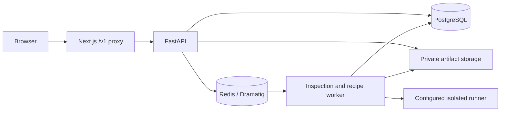

# Flexy developer handbook

A deliberately narrow `.deb` inspection and package-conversion service. The supported recipe is the included demo fixture targeting Arch Linux x86_64; a package artifact does not prove installation, launch, or application compatibility.

## Start locally

Use Docker Engine with Compose v2:

```sh
cp .env.example .env
docker compose up --build
```

Web is at http://localhost:3000 and API at http://localhost:8000. Upload `fixtures/flexy-demo_1.0.0_amd64.deb` for the supported recipe and the unsupported fixture to check rejection. Build availability depends on the selected validated runner; unavailable isolation must remain a reported failure.

## Architecture



`backend/app/main.py` defines the public job API. `inspection/deb.py` parses archives without executing uploaded code; recipes define exact accepted payloads. Domain/models/repository modules represent persisted jobs and transitions; queue/worker/services coordinate work. `storage.py` handles artifacts, `security.py` capability/token checks, and runners implement Bubblewrap, Kubernetes, or restricted WASI paths. Native remote-build support has a separate router and bridge/guest scripts.

## API lifecycle

`POST /v1/jobs` accepts an upload and returns a job capability. Scoped access is needed to retrieve `/v1/jobs/{job_id}`, stream `/events`, request `/build`, and request an artifact download token. `/v1/downloads/{token}` consumes a short-lived download token. Read `backend/app/main.py` for exact header and body shapes; the route reference links every handler. `/healthz` and `/readyz` distinguish process and readiness checks.

Treat capabilities and tokens as credentials. Reports separately track package creation, installation, launch, and functionality. WASI repackaging only creates the narrowly supported unsigned package; native execution checks need their own validated environment.

## Configuration and deployment

`FLEXY_API_UPSTREAM` is a server-only Next.js proxy destination. `NEXT_PUBLIC_API_BASE_URL`, if used, is a build-time public origin. A frontend-only deployment returns an explicit unavailable-backend response until the API stack exists.

`compose.dokploy.yaml` defaults to `BUILD_EXECUTOR=unavailable`; the personal profile supports explicit restricted WASI operation. PostgreSQL, Redis, storage, migration, API, and worker services have distinct roles. The native-worker guide covers outbound bridge authentication. Follow `docs/deployment.md`, `docs/dokploy.md`, `docs/native-worker.md`, and `docs/security.md` for the supported configurations. Do not turn off runner isolation to make a build appear successful.

## Checks and maintenance

`make check` invokes helper tests, Compose validation, backend/frontend checks, and Kubernetes rendering; Docker and kustomize are needed for those targets. The GitHub workflow defines frontend checks, helper/backend tests, image checks, and disposable full-stack Playwright verification. Python requires 3.11+; frontend CI/local instructions use Node.js 22.

When adding a recipe, update fixture provenance, dependency mappings, exact payload checks, unsupported-input tests, and execution evidence separately. Preserve stored data before migrations. Named volumes hold service state; deleting volumes is not a routine restart. Cleanup expires jobs/artifacts according to retention configuration, so download needed artifacts before expiry.

## More documentation

- [Source, command, and configuration reference](REFERENCE.md)
- [Contributing](../CONTRIBUTING.md)
